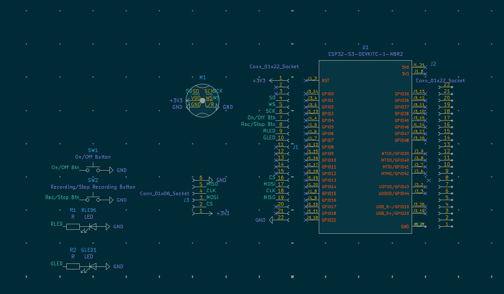
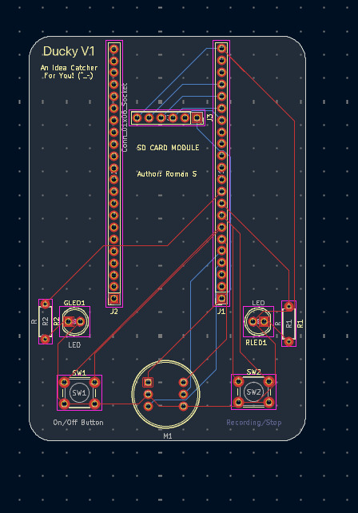
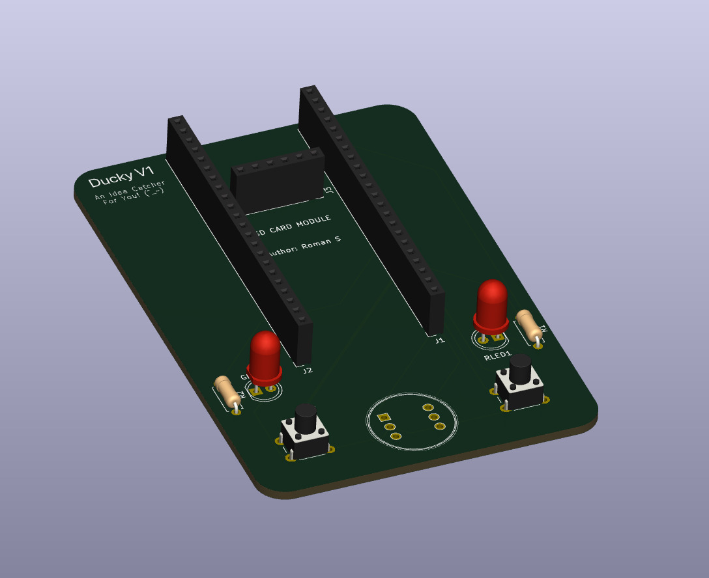

# 🐥 Ducky

A pocket-sized, offline audio recorder built on a custom PCB to capture ideas quickly without phone notifications or cloud uploads.

---

## What It Is
Ducky is an open-source hardware voice recorder powered by an ESP32-S3. It records clean audio using an INMP441 digital microphone and saves standard `.wav` files directly to a microSD card.

---

## Why It Was Made
- **No distractions:** Phones pull you into notifications, texts, and apps. Ducky is strictly for capturing thoughts.
- **Complete privacy:** Audio stays 100% offline on your physical SD card—no accounts, Wi-Fi, or cloud servers.
- **Fast capture:** Turn it on and start talking with a single click.

---

## How It's Used

| Step | Action | Details |
| :---: | :--- | :--- |
| **1** | **Power on** | Insert a microSD card, connect power, and press the **On/Off button**. The LED turns on. |
| **2** | **Record** | Press the **Record/Stop button**. The status LED lights up to confirm active recording. |
| **3** | **Save** | Press the **Record/Stop button** again to finish and cleanly save the `.wav` file. |
| **4** | **Listen** | Pop the SD card into any computer or phone card reader to play your files. |

---

## Features
- **Clean Audio:** Omnidirectional INMP441 MEMS microphone with direct digital I2S sound.
- **Local Storage:** Writes uncompressed `.wav` files straight to a microSD card.
- **Simple Controls:** 2 tactile buttons (On/Off and Record/Stop).
- **Status LEDs:** Clear visual indicators for standby and active recording.
- **Modular Board:** Socketed female headers make inserting or swapping the ESP32-S3 easy.

---

## Hardware & PCB

Designed in KiCad with dedicated routing for I2S audio lines, status indicators, and power rails.

### Schematic

### 2D PCB Layout

### 3D Render

---

## Firmware
Written in C++ with the Arduino IDE. It streams digital microphone audio via I2S through DMA buffers and writes `.wav` audio directly to the SD card.

---

## Bill of Materials (BOM)

| Part | Qty | Purpose |
| :--- | :---: | :--- |
| **ESP32-S3 Dev Board** | 1 | Main microcontroller |
| **INMP441 Microphone** | 1 | Digital I2S voice input |
| **MicroSD Card Module** | 1 | Local audio storage |
| **Tactile Buttons** | 2 | On/Off power and Record/Stop toggle |
| **Status LEDs** | 2 | Standby and recording indicators |
| **1x22 Female Socket Header** | 1 | Dev board socket mount |
| **Custom Ducky PCB** | 1 | Custom carrier board |

🔗 **[View Full BOM Spreadsheet](https://docs.google.com/spreadsheets/d/1QnwAKiJmGDgImrsn4VjBF_kzMT8kdfhP0gqPE6i_Km0/edit?usp=sharing)**

---

## Author
Built by [@Romanhery](https://github.com/Romanhery)
